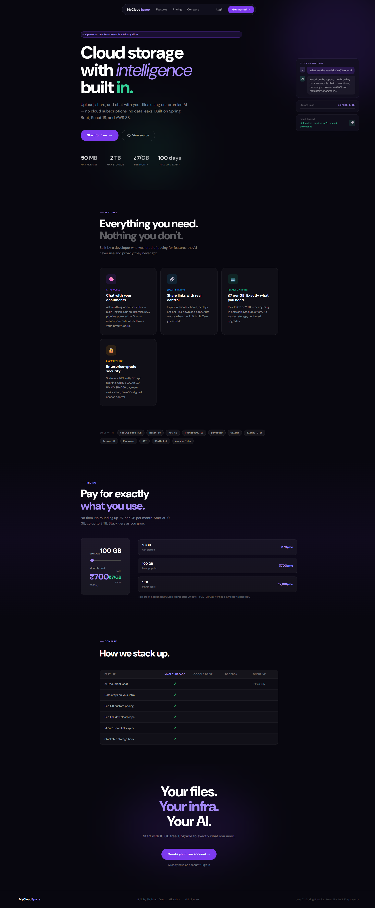
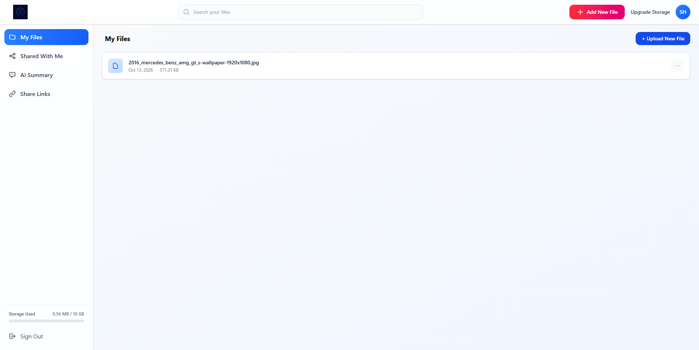
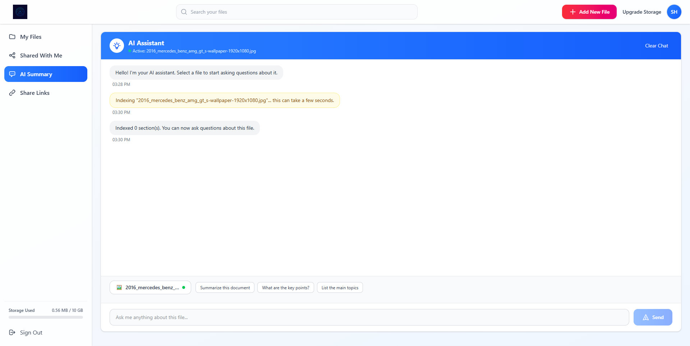
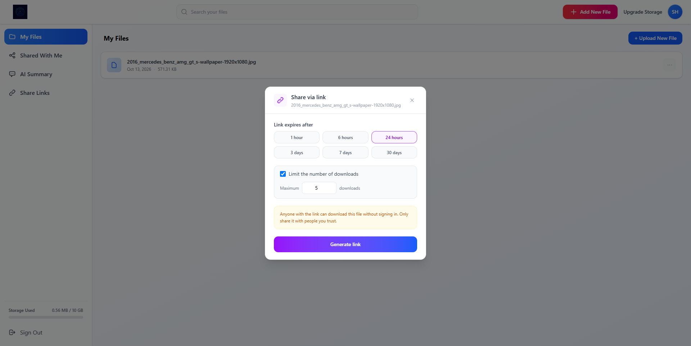
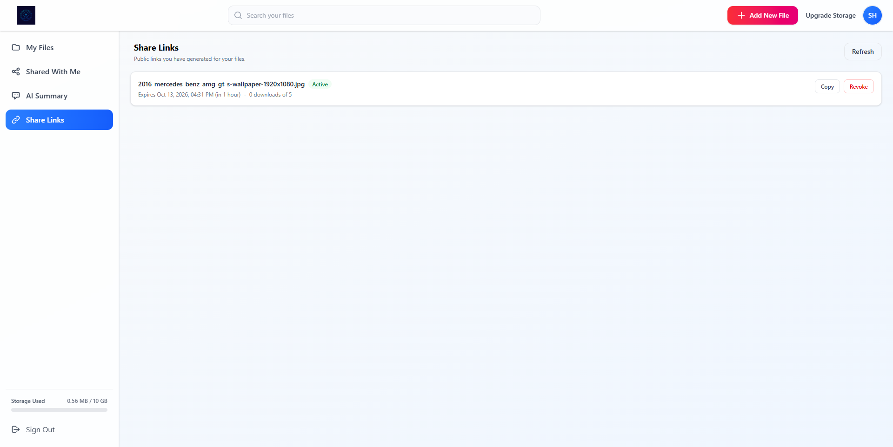
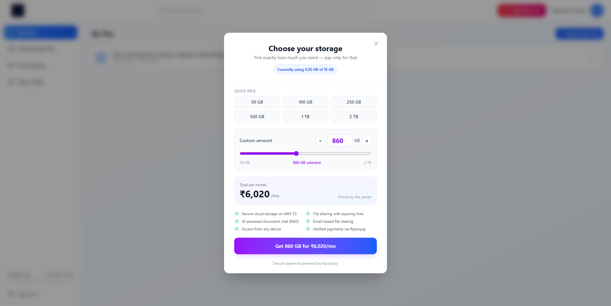

<div align="center">

# ☁️ MyCloudSpace

### An AI-Powered Cloud File Storage & Sharing Platform

[](https://openjdk.org/projects/jdk/21/)
[](https://spring.io/projects/spring-boot)
[](https://react.dev/)
[](https://github.com/pgvector/pgvector)
[](https://aws.amazon.com/s3/)
[](https://ollama.com/)
[](LICENSE)

**MyCloudSpace** is a full-stack cloud file storage and sharing platform with an on-premise AI document intelligence layer. Upload, organise and share files securely, and chat with your documents using a locally hosted LLM. No document content is sent to an external AI service.

[Screenshots](#-screenshots) · [Features](#-features) · [Tech Stack](#️-tech-stack) · [Getting Started](#-getting-started) · [Configuration](#️-configuration-reference) · [API Reference](#-api-reference) · [Architecture](#-rag-pipeline-architecture) · [Contributing](#-contributing)

</div>

---

## 📸 Screenshots

<div align="center">

<a href="https://youtu.be/xQpMwtHLqhc">
  
</a>

<sub>▶️ <a href="https://youtu.be/xQpMwtHLqhc"><b>Watch the full demo on YouTube</b></a> (1:30)</sub>

</div>

<table>
  <tr>
    <td align="center" width="50%">
      
      <br /><sub><b>Landing page</b></sub>
    </td>
    <td align="center" width="50%">
      
      <br /><sub><b>Dashboard</b>: files, search and storage usage</sub>
    </td>
  </tr>
  <tr>
    <td align="center" width="50%">
      
      <br /><sub><b>AI Summary</b>: chat with a document, with cited sources</sub>
    </td>
    <td align="center" width="50%">
      
      <br /><sub><b>Share link</b>: expiry presets and a download limit</sub>
    </td>
  </tr>
  <tr>
    <td align="center" width="50%">
      
      <br /><sub><b>Share Links</b>: status, download count, copy and revoke</sub>
    </td>
    <td align="center" width="50%">
      
      <br /><sub><b>Upgrade storage</b>: pay-per-GB with Razorpay</sub>
    </td>
  </tr>
</table>

---

## ✨ Features

### 🔐 Authentication & Security
- **JWT authentication**: stateless HS256 tokens carrying the user ID and role, with a 10-hour default expiry. Startup fails fast if the signing secret is shorter than 32 bytes.
- **BCrypt password hashing** for all locally registered accounts
- **GitHub OAuth 2.0 login**: after sign-in the backend issues a JWT and redirects to the SPA. Logging in with a provider that differs from the one an email was registered with is refused (`provider_mismatch`), and so is a GitHub profile with no email (`no_email`).
- **Roles**: `NORMAL`, `PRO`, `PREMIUM`, `ULTIMATE`, `ADMIN` and `DISABLED`. Admin-only endpoints are enforced with `@PreAuthorize`, and disabled accounts are rejected at login and on every request.
- **Ownership checks on every resource**: users can only read, share, ingest or delete files they own or that were shared with them
- **Consistent JSON errors**: a global exception handler returns one error shape (with per-field validation messages) and never leaks stack traces or internal messages
- **Bean Validation** on all request bodies (email format, password length, storage range, link expiry, and more)
- **Configurable CORS whitelist**: only origins listed in `CORS_ALLOWED_ORIGINS` are accepted

### 📁 File Management
- **AWS S3 storage** with server-side encryption (AES-256) and collision-free UUID-prefixed object keys
- **Multipart upload** through the API with a live progress bar in the UI (100 MB default limit, configurable)
- **Server-side quota enforcement**: the user row is locked during the quota check, so concurrent uploads cannot overshoot the limit
- **Filename sanitisation**: path segments, control characters and quotes are stripped, and names are capped at 255 characters
- **Search**: case-insensitive filename search with a debounced search bar
- **Downloads** with correct `Content-Disposition` (UTF-8 filenames), plus 15-minute pre-signed S3 URLs on the file metadata endpoint
- **Clean deletes**: deleting a file also removes its share links, user shares, AI embeddings and S3 object, and frees its quota
- **Optional description and tags** per file

### 👥 User-to-User Sharing
- Share any file you own with another registered user by email
- See who a file is shared with, and remove access per user
- **Shared With Me** view lists files other users have shared with you

### 🔗 Public Share Links
- **Unguessable tokens**: 256-bit cryptographically random hex tokens, so no login is needed to download
- **Configurable expiry** from 1 minute to 30 days (the UI offers 1h / 6h / 24h / 3d / 7d / 30d presets)
- **Optional download cap** from 1 to 1000 downloads, enforced with an atomic counter so concurrent downloads cannot exceed it
- **HTTP 410 Gone** for revoked, expired or exhausted links
- **Share Links dashboard**: every active link with a status badge (Active / Expired / Limit reached / Revoked), the download count, one-click copy and revoke
- **Scheduled cleanup**: an hourly job deactivates expired links

### 🤖 AI Document Intelligence (RAG)
- **100% on-premise**: embeddings and answers are generated locally by Ollama
- **Text extraction** with Apache Tika (PDF, DOCX, PPTX, XLSX, TXT, HTML and more)
- **Token-based chunking**: 800-token chunks with a 350-character minimum
- **Embeddings**: `nomic-embed-text`, 768 dimensions
- **Vector store**: PostgreSQL + pgvector with an HNSW index and cosine distance. The schema is created automatically.
- **Retrieval scoped by metadata**: every chunk is tagged with `userId` and `fileId`, so searches only ever see the caller's own documents. Leaving out `fileId` searches across all of the user's indexed files.
- **Grounded answers** from `llama3.2:1b`, with a system prompt that treats document text as data rather than instructions (a guard against prompt injection)
- **Source citations**: each answer returns the chunks it was based on, and the UI shows them under the reply
- **Multi-turn memory**: up to 20 messages per user, evicted after 2 hours idle
- **Re-indexing is idempotent**: ingesting a file again replaces its old vectors
- **Indexed-state tracking**: the file picker knows which files are already indexed and skips re-ingesting them

### 💳 Storage Subscriptions (Razorpay)
- **Pay-per-GB pricing**: ₹7 / GB / month by default (configurable), from 10 GB up to 2 TB
- **Price computed on the server**: the client only sends the GB amount, so it cannot change the price
- **Order lifecycle**: a pending order is recorded at creation, then verified (order ownership plus a constant-time HMAC-SHA256 signature check) and completed idempotently
- **Stackable tiers**: each purchase adds storage for one month, and a nightly job deactivates expired tiers
- **Effective quota** = 10 GB free base storage + the sum of all active tiers
- **Live pricing calculator** with a slider, preset sizes (50 GB to 2 TB) and server-side quotes

### 🖥️ Frontend
- **React 19 SPA** built with Vite 7 and styled with Tailwind CSS 4
- **Central Axios client** that attaches the JWT, signs the user out automatically on `401`, and turns API errors into readable messages
- **Session restore** on page load via `/api/user/me`
- **Route guards**: `ProtectedRoute` for the dashboard and `PublicOnlyRoute` for login/register
- **Dashboard views**: My Files, Shared With Me, AI Summary (chat) and Share Links
- **Storage usage bar** in the sidebar, with a warning when the quota is nearly full
- **Drag-and-drop upload**, confirmation dialogs for destructive actions, toast notifications, an error boundary and a 404 page

---

## 🛠️ Tech Stack

### Backend
| Layer | Technology |
|---|---|
| Language | Java 21 |
| Framework | Spring Boot 3.5 |
| Security | Spring Security 6, OAuth2 Client, JJWT 0.11.5 |
| Persistence | Spring Data JPA / Hibernate |
| Database | PostgreSQL + pgvector |
| Cloud Storage | AWS SDK v2 (S3 + S3 Presigner) |
| AI Framework | Spring AI (Ollama, pgvector vector store, Tika document reader) |
| LLM Runtime | Ollama: `llama3.2:1b` (chat), `nomic-embed-text` (embeddings) |
| Payments | Razorpay Java SDK 1.4.1 |
| Validation | Jakarta Bean Validation |
| Build | Maven (wrapper included) |
| Utilities | Lombok |

### Frontend
| Layer | Technology |
|---|---|
| UI Library | React 19 |
| Build Tool | Vite 7 |
| Styling | Tailwind CSS 4 (`@tailwindcss/vite`) |
| Routing | React Router 7 |
| HTTP Client | Axios |
| State | React Context (`AppContext` + `useApp` hook) |
| Notifications | react-toastify |
| Payment UI | Razorpay Checkout.js (loaded on demand) |
| Linting | ESLint 9 |

---

## 🚀 Getting Started

### Prerequisites

| Tool | Version | Notes |
|---|---|---|
| JDK | 21 | [Temurin](https://adoptium.net/) or [Amazon Corretto](https://aws.amazon.com/corretto/) |
| Maven | 3.9+ | Optional: the `mvnw` / `mvnw.cmd` wrapper is included |
| Node.js | 20.19+ or 22.12+ | Required by Vite 7 |
| PostgreSQL | 14+ | With the [`pgvector`](https://github.com/pgvector/pgvector) extension installed |
| Ollama | Latest | [Install guide](https://ollama.com/) |
| AWS account | n/a | An S3 bucket and an IAM user with `s3:PutObject`, `s3:GetObject` and `s3:DeleteObject` |
| Razorpay account | n/a | Test-mode keys are fine for development |
| GitHub OAuth app | n/a | Only needed for the "Sign in with GitHub" button |

---

### 1. Clone the repository

```bash
git clone https://github.com/jokerking-6178/MyCloudSpace.git
cd MyCloudSpace
```

### 2. Set up PostgreSQL

```sql
CREATE DATABASE "my-cloud-space";
\c "my-cloud-space"

-- Required for AI embeddings. Spring AI also tries to create it on startup,
-- but that needs superuser rights, so create it up front.
CREATE EXTENSION IF NOT EXISTS vector;
```

Hibernate creates the application tables on first start (`ddl-auto=update`), and Spring AI creates the `vector_store` table and its HNSW index (`initialize-schema=true`).

> **Upgrading an existing database?** If your `users` table was created before the `ADMIN` role existed, run [`db/001-add-admin-role.sql`](db/001-add-admin-role.sql) once. Hibernate never updates an existing check constraint. Fresh databases don't need it.

### 3. Pull the Ollama models

Models are **not** pulled automatically (`pull-model-strategy=never`), so pull them yourself:

```bash
ollama pull llama3.2:1b        # chat / answer generation
ollama pull nomic-embed-text   # embeddings
ollama list                    # verify both are present
```

Ollama listens on `http://localhost:11434` by default. Keep it running while the backend is up.

### 4. Configure the backend

All secrets come from environment variables. Nothing sensitive lives in `application.properties`. Copy [`env.example`](env.example) and fill it in:

```bash
cp env.example .env
```

```env
DB_URL=jdbc:postgresql://localhost:5432/my-cloud-space
DB_USERNAME=postgres
DB_PASSWORD=change-me

JWT_SECRET=replace-with-a-long-random-secret-at-least-32-bytes
JWT_EXPIRATION_MS=36000000

AWS_ACCESS_KEY=...
AWS_SECRET_KEY=...
AWS_REGION=ap-south-1
AWS_BUCKET_NAME=...

GITHUB_CLIENT=...
GITHUB_SECRET=...

RAZORPAY_KEY=...
RAZORPAY_SECRET=...
```

> Spring Boot does **not** read `.env` files by itself. Export the variables in your shell, add them to your IDE run configuration (IntelliJ: *Run → Edit Configurations → Environment variables*), or use an EnvFile plugin. `.env` is git-ignored.

See the [Configuration Reference](#️-configuration-reference) for every variable and its default.

### 5. Run the backend

```bash
# macOS / Linux
./mvnw spring-boot:run

# Windows
mvnw.cmd spring-boot:run

# Or build a JAR
./mvnw clean package -DskipTests
java -jar target/MyCloudSpace-0.0.1-SNAPSHOT.jar
```

The API starts on **http://localhost:8081**.

### 6. Configure and run the frontend

```bash
cd my-cloud-space
npm install
cp .env.example .env     # sets VITE_API_URL=http://localhost:8081
npm run dev
```

The SPA starts on **http://localhost:5173**. It calls the API directly at `VITE_API_URL` (there is no dev proxy), so the frontend's origin must be listed in `CORS_ALLOWED_ORIGINS`. `http://localhost:5173` and `http://localhost:3000` are allowed by default.

Other scripts: `npm run build`, `npm run preview`, `npm run lint`.

### 7. GitHub OAuth setup (optional)

1. Go to **GitHub → Settings → Developer settings → OAuth Apps → New OAuth App**
2. **Homepage URL:** `http://localhost:5173`
3. **Authorization callback URL:** `http://localhost:8081/login/oauth2/code/github`
4. Put the Client ID and Client Secret in `GITHUB_CLIENT` / `GITHUB_SECRET`

The SPA's "Sign in with GitHub" button goes to `/oauth2/authorization/github`. After a successful login the backend redirects to `OAUTH2_REDIRECT_URI` (default `http://localhost:5173/oauth2/redirect`) with `?token=<jwt>`, or with `?error=no_email` / `?error=provider_mismatch` if the login was refused.

### 8. Create an admin (optional)

There is no sign-up path for admins. Promote an existing account directly in the database:

```sql
UPDATE users SET role = 'ADMIN' WHERE email = 'you@example.com';
```

---

## ⚙️ Configuration Reference

### Backend environment variables

| Variable | Required | Default | Description |
|---|---|---|---|
| `DB_URL` | | `jdbc:postgresql://localhost:5432/my-cloud-space` | PostgreSQL JDBC URL |
| `DB_USERNAME` | | `postgres` | Database user |
| `DB_PASSWORD` | ✅ | none | Database password (the app will not start without it) |
| `JWT_SECRET` | ✅ | none | HS256 signing secret, **at least 32 bytes** |
| `JWT_EXPIRATION_MS` | | `36000000` (10 h) | Token lifetime |
| `AWS_ACCESS_KEY` | ✅ | none | IAM access key ID |
| `AWS_SECRET_KEY` | ✅ | none | IAM secret access key |
| `AWS_REGION` | | `ap-south-1` | Bucket region |
| `AWS_BUCKET_NAME` | ✅ | none | S3 bucket name |
| `GITHUB_CLIENT` | ✅* | none | GitHub OAuth client ID |
| `GITHUB_SECRET` | ✅* | none | GitHub OAuth client secret |
| `RAZORPAY_KEY` | ✅* | none | Razorpay key ID (also sent to the browser for Checkout) |
| `RAZORPAY_SECRET` | ✅* | none | Razorpay key secret (server only) |
| `CORS_ALLOWED_ORIGINS` | | `http://localhost:5173,http://localhost:3000` | Comma-separated allowed origins |
| `OAUTH2_REDIRECT_URI` | | `http://localhost:5173/oauth2/redirect` | Where the SPA receives the OAuth JWT |
| `OLLAMA_BASE_URL` | | `http://localhost:11434` | Ollama server |
| `MAX_UPLOAD_SIZE` | | `100MB` | Maximum file and request size |

\* The property must resolve for the app to start. Use placeholder values if you don't need GitHub login or payments.

The frontend upload dialog also checks for 100 MB on the client (`MAX_UPLOAD_BYTES` in `FileUpload.jsx`). If you change `MAX_UPLOAD_SIZE`, update that constant too.

### Tunable application properties

These are set in [`application.properties`](src/main/resources/application.properties) and can be overridden in the usual Spring ways.

| Property | Default | Description |
|---|---|---|
| `server.port` | `8081` | API port |
| `aws.presigned-url-minutes` | `15` | Lifetime of pre-signed download URLs |
| `app.pricing.rupees-per-gb` | `7` | Monthly price per GB (INR) |
| `app.pricing.tier-months` | `1` | How long a purchased tier lasts |
| `app.pricing.expiry-cron` | `0 0 0 * * *` | When expired tiers are deactivated |
| `app.share.cleanup-interval-ms` | `3600000` | How often expired share links are cleaned up |
| `rag.chunk-size` | `800` | Tokens per chunk |
| `rag.min-chunk-size-chars` | `350` | Minimum chunk size in characters |
| `rag.similarity-threshold` | `0.5` | Minimum similarity for retrieved chunks |
| `rag.conversation.max-messages` | `20` | Chat history kept per user |
| `rag.conversation.ttl-minutes` | `120` | Idle time before a conversation is evicted |
| `spring.ai.ollama.chat.model` | `llama3.2:1b` | Chat model |
| `spring.ai.ollama.embedding.model` | `nomic-embed-text` | Embedding model (must output 768 dimensions, or change `pgvector.dimensions`) |

### Frontend environment variables

| Variable | Default | Description |
|---|---|---|
| `VITE_API_URL` | `http://localhost:8081` | Base URL of the Spring Boot API |

---

## 📁 Project Structure

```
MyCloudSpace/
├── db/
│   └── 001-add-admin-role.sql              # One-off migration for pre-ADMIN databases
├── env.example                             # Backend environment variable template
├── pom.xml
├── src/
│   ├── main/
│   │   ├── java/com/MyProject/MyCloudSpace/
│   │   │   ├── config/
│   │   │   │   ├── AiConfig.java               # ChatClient + TokenTextSplitter beans
│   │   │   │   ├── AwsS3Config.java            # S3Client + S3Presigner beans
│   │   │   │   └── SecurityConfig.java         # Filter chain, CORS, OAuth2, JSON 401/403
│   │   │   ├── controller/
│   │   │   │   ├── AuthController.java         # POST /api/user/login
│   │   │   │   ├── UserController.java         # /api/user/** (register, me, admin ops)
│   │   │   │   ├── FileController.java         # /api/files/**
│   │   │   │   ├── ShareableLinkController.java# /api/share/**
│   │   │   │   ├── RagController.java          # /api/rag/**
│   │   │   │   └── PaymentController.java      # /api/payments/**
│   │   │   ├── Entity/                         # UserEntity, FileEntity, ShareableLinkEntity,
│   │   │   │                                   # PaymentEntity, Role, AuthProvider, PaymentStatus
│   │   │   ├── exception/                      # ApiException hierarchy + GlobalExceptionHandler
│   │   │   ├── filter/
│   │   │   │   └── JwtAuthenticationFilter.java
│   │   │   ├── io/                             # Request/response DTOs (with validation)
│   │   │   ├── repository/                     # Spring Data JPA repositories
│   │   │   ├── security/
│   │   │   │   └── AppUserPrincipal.java       # UserDetails used across the app
│   │   │   ├── service/                        # Service interfaces
│   │   │   │   └── impl/
│   │   │   │       ├── FileServiceImpl.java        # Upload, search, share, delete
│   │   │   │       ├── S3Service.java              # S3 put/get/delete/presign
│   │   │   │       ├── ShareableLinkImpl.java      # Link create/download/revoke/cleanup
│   │   │   │       ├── RagServiceImpl.java         # Ingest, retrieve, answer
│   │   │   │       ├── ConversationStore.java      # In-memory chat history with TTL
│   │   │   │       ├── StorageTierImpl.java        # Pricing, quota, tier lifecycle
│   │   │   │       ├── RazorpayServiceImpl.java    # Orders + signature verification
│   │   │   │       ├── UserServiceImpl.java
│   │   │   │       ├── AppUserDetailService.java
│   │   │   │       └── CustomOAuth2UserService.java
│   │   │   ├── util/
│   │   │   │   ├── JwtUtil.java
│   │   │   │   └── Oauth2SuccessHandler.java   # Links/creates user, issues JWT, redirects
│   │   │   └── MyCloudSpaceApplication.java    # Entry point (@EnableScheduling)
│   │   └── resources/
│   │       └── application.properties
│   └── test/
│       └── java/.../MyCloudSpaceApplicationTests.java
└── my-cloud-space/                             # React frontend
    ├── .env.example
    ├── vite.config.js
    ├── package.json
    └── src/
        ├── App.jsx                             # Routes
        ├── main.jsx
        ├── components/
        │   ├── common/                         # ConfirmDialog, ErrorBoundary, FullPageSpinner
        │   ├── context/                        # AppContext provider + instance
        │   ├── FileUpload/FileUpload.jsx       # Drag & drop + progress
        │   ├── Login/  Register/  Navbar/  Sidebar/
        │   ├── MyFiles/MyFile.jsx              # File row + actions menu
        │   ├── OauthHandler/OAuth2RedirectHandler.jsx
        │   ├── Pricing/Pricing.jsx             # Storage calculator + Razorpay checkout
        │   ├── SharedFile/                     # SharedFile, ShareFileModal,
        │   │                                   # ShareableLinkModal, ShareLinksManager
        │   └── Summary/                        # Summary, ChatMessage, FilePicker, useRag
        ├── hooks/useApp.js
        ├── pages/                              # Landing, dashboard/Dashboard, NotFound
        ├── routes/                             # ProtectedRoute, PublicOnlyRoute
        ├── service/                            # apiClient, auth, file, shareLink, rag, payment
        └── utils/format.js                     # Date/byte formatting helpers
```

---

## 📡 API Reference

Base URL: `http://localhost:8081`. Protected endpoints need:

```
Authorization: Bearer <jwt_token>
```

The user is always taken from the token. No endpoint accepts a `userId` to act on someone else's behalf.

### Authentication & Users
| Method | Endpoint | Auth | Description |
|---|---|---|---|
| `POST` | `/api/user/register` | Public | Create an account (`email`, `username` 3–40 chars, `password` ≥ 8 chars) |
| `POST` | `/api/user/login` | Public | Returns `{ email, token, user }` |
| `GET` | `/oauth2/authorization/github` | Public | Start GitHub login |
| `GET` | `/api/user/me` | JWT | Current user, including `storageUsed` (bytes) and `maxStorage` (GB) |
| `DELETE` | `/api/user/me` | JWT | Delete your own account and its S3 objects |
| `GET` | `/api/user/{id}` | ADMIN | Get any user |
| `DELETE` | `/api/user/{id}` | ADMIN | Delete any user |
| `PUT` | `/api/user/{id}/role` | ADMIN | Change a user's role (body: `"PRO"`) |
| `PUT` | `/api/user/{id}/disable` | ADMIN | Disable an account |

### Files
| Method | Endpoint | Auth | Description |
|---|---|---|---|
| `POST` | `/api/files/upload` | JWT | Multipart upload: `file` (required), `description`, `tags` |
| `GET` | `/api/files?q=` | JWT | List your files, newest first. `q` filters by filename. |
| `GET` | `/api/files/shared` | JWT | Files other users shared with you |
| `GET` | `/api/files/{fileId}` | JWT | File metadata plus a 15-minute pre-signed `downloadUrl` |
| `GET` | `/api/files/{fileId}/download` | JWT | Download the file |
| `DELETE` | `/api/files/{fileId}` | JWT | Delete a file (owner only) |

### User-to-User Sharing
| Method | Endpoint | Auth | Description |
|---|---|---|---|
| `GET` | `/api/files/{fileId}/shares` | JWT | Emails the file is shared with |
| `POST` | `/api/files/{fileId}/shares` | JWT | Share with a user. Body: `{ "email": "..." }` |
| `DELETE` | `/api/files/{fileId}/shares?email=` | JWT | Remove a user's access |

### Public Share Links
| Method | Endpoint | Auth | Description |
|---|---|---|---|
| `POST` | `/api/share/links/{fileId}` | JWT | Create a link. Body: `{ "expirySeconds": 60–2592000, "maxDownloads": 1–1000 \| null }` |
| `GET` | `/api/share/links` | JWT | Your links, with `usable`, `expired`, `revoked` and `downloadLimitReached` flags |
| `DELETE` | `/api/share/links/{token}` | JWT | Revoke a link |
| `GET` | `/api/share/download/{token}` | **Public** | Download via link. Returns `410 Gone` if revoked, expired or exhausted. |

### AI / RAG
| Method | Endpoint | Auth | Description |
|---|---|---|---|
| `POST` | `/api/rag/ingest/{fileId}` | JWT | Extract, chunk and embed a file you own. Returns the chunk count. |
| `GET` | `/api/rag/ingested` | JWT | IDs of your files that are already indexed |
| `POST` | `/api/rag/chat` | JWT | Body: `{ "question": "...", "fileId": 42?, "topK": 1–20? }`. Returns `{ answer, sources[] }`. |
| `DELETE` | `/api/rag/conversation` | JWT | Clear your chat history |

### Payments
| Method | Endpoint | Auth | Description |
|---|---|---|---|
| `GET` | `/api/payments/config` | JWT | Razorpay public key ID and currency |
| `GET` | `/api/payments/quote?storageGb=` | JWT | Price for 10–2000 GB |
| `POST` | `/api/payments/create-order` | JWT | Body: `{ "storageGb": 100 }`. Creates a Razorpay order and records it as pending. |
| `POST` | `/api/payments/verify` | JWT | Body: `{ razorpayOrderId, razorpayPaymentId, razorpaySignature }`. Verifies the payment and grants the storage. |
| `GET` | `/api/payments/tiers` | JWT | Your active storage tiers |

### Error format

Every error, including 401/403 from the security layer, uses the same shape:

```json
{
  "timestamp": "2026-10-13T09:15:02.118Z",
  "status": 400,
  "error": "Bad Request",
  "message": "Validation failed.",
  "path": "/api/user/register",
  "fieldErrors": { "password": "Password must be at least 8 characters" }
}
```

| Status | When |
|---|---|
| `400` | Validation or malformed request |
| `401` | Missing or expired token, or wrong credentials |
| `403` | Not the owner, admin-only endpoint, or disabled account |
| `404` | Unknown file, user, order or link |
| `409` | Email already registered |
| `410` | Share link revoked, expired or at its download limit |
| `413` | Upload larger than `MAX_UPLOAD_SIZE`, or over your storage quota |
| `503` | Ollama is not reachable (AI ingestion or chat) |

### Example requests

**Register and log in**
```bash
curl -X POST http://localhost:8081/api/user/register \
  -H "Content-Type: application/json" \
  -d '{"email":"user@example.com","username":"shubham","password":"securepassword"}'

curl -X POST http://localhost:8081/api/user/login \
  -H "Content-Type: application/json" \
  -d '{"email":"user@example.com","password":"securepassword"}'
```

**Upload a file**
```bash
curl -X POST http://localhost:8081/api/files/upload \
  -H "Authorization: Bearer $TOKEN" \
  -F "file=@/path/to/report.pdf" \
  -F "description=Quarterly report" \
  -F "tags=finance,2026"
```

**Search your files**
```bash
curl "http://localhost:8081/api/files?q=report" -H "Authorization: Bearer $TOKEN"
```

**Create a share link (2 hours, max 5 downloads)**
```bash
curl -X POST http://localhost:8081/api/share/links/42 \
  -H "Authorization: Bearer $TOKEN" \
  -H "Content-Type: application/json" \
  -d '{"expirySeconds":7200,"maxDownloads":5}'
```

**Index a document and ask about it**
```bash
curl -X POST http://localhost:8081/api/rag/ingest/42 -H "Authorization: Bearer $TOKEN"

curl -X POST http://localhost:8081/api/rag/chat \
  -H "Authorization: Bearer $TOKEN" \
  -H "Content-Type: application/json" \
  -d '{"fileId":42,"question":"What are the key financial highlights?"}'
```

---

## 🔄 RAG Pipeline Architecture

```
Ingestion  (POST /api/rag/ingest/{fileId})
──────────────────────────────────────────
File bytes (S3)
      │
      ▼
Apache Tika ──► plain text
      │
      ▼
Tag metadata { userId, fileId, fileName }
      │
      ▼
TokenTextSplitter (800 tokens, ≥350 chars)
      │
      ▼
Delete old vectors for fileId  ◄── makes re-ingest idempotent
      │
      ▼
nomic-embed-text (Ollama) ──► 768-dim vectors
      │
      ▼
pgvector `vector_store` (HNSW, cosine) ──► chunk count returned


Query  (POST /api/rag/chat)
───────────────────────────
Question ──► nomic-embed-text ──► query vector
                                       │
          similarity search, topK (default 5), threshold 0.5,
          filter: userId == caller [AND fileId == selected]
                                       │
                            no matches? ──► "couldn't find anything" reply
                                       │
          prompt = system guardrails + chat history (≤20 msgs)
                   + retrieved chunks + question
                                       │
                            llama3.2:1b (Ollama)
                                       │
                   { answer, sources[] } ──► user
```

---

## 🧪 Testing

```bash
./mvnw test        # backend
cd my-cloud-space && npm run lint   # frontend lint
```

The backend currently has a single Spring context-load smoke test (`MyCloudSpaceApplicationTests`). It boots the full application context, so it needs the same environment variables, PostgreSQL and Ollama as a normal run. Unit and integration tests are on the roadmap.

---

## 🔒 Security Notes

- ✅ BCrypt password hashing
- ✅ HS256 JWTs with an enforced minimum key length. Disabled users are rejected even if they hold a valid token.
- ✅ Every file, link, ingestion and payment operation is checked against the authenticated user
- ✅ Storage quota enforced on the server under a row lock
- ✅ Payment amount computed on the server, the order checked against its owner, the signature compared in constant time, and completion idempotent
- ✅ Share-link tokens are 256-bit `SecureRandom` values, and download caps use an atomic counter
- ✅ S3 objects are encrypted at rest (SSE-S3 / AES-256)
- ✅ Parameterised JPA queries only
- ✅ No stack traces or internal messages in API responses
- ✅ All secrets come from environment variables, and the DB password has no fallback
- ✅ Document content never leaves your infrastructure for AI processing

To report a vulnerability, please open a private [GitHub Security Advisory](https://github.com/jokerking-6178/MyCloudSpace/security/advisories/new) rather than a public issue.

---

## 🚧 Known Limitations

- **Downloads are buffered in memory**: the API reads the whole object from S3 before sending it, so very large files use a lot of heap
- **Chat history is in-memory**: it is lost on restart and not shared between multiple backend instances
- **CPU inference is slow**: RAG answers take several seconds on CPU, and a GPU is recommended for Ollama
- **Single-file chat in the UI**: the API can search across all of a user's documents (omit `fileId`), but the chat UI always scopes to one file
- **No OCR**: images and scanned PDFs have no text layer, so they can't be indexed for AI chat (the API returns a clear `400`)
- **No file preview**: files must be downloaded to view them
- **Google OAuth is only partly wired up**: the success handler recognises Google, but no client registration is configured
- **Storage is coupled to AWS S3**
- **Minimal automated test coverage**

---

## 🗺️ Roadmap

- [ ] Unit and integration test suite (services, controllers, security)
- [ ] Stream downloads instead of buffering them in memory
- [ ] Docker Compose for one-command local setup (PostgreSQL + pgvector + Ollama + API + SPA)
- [ ] File preview using pre-signed URLs (PDF.js, images)
- [ ] Multi-document chat in the UI
- [ ] Persistent / distributed chat memory
- [ ] Google OAuth registration
- [ ] Admin dashboard in the frontend
- [ ] Larger or configurable chat models (e.g. `llama3.2:3b`, `llama3.1:8b`)
- [ ] S3 object versioning
- [ ] Real-time notifications for share events

---

## 🤝 Contributing

1. **Fork** the repository
2. **Create a feature branch**: `git checkout -b feature/your-feature-name`
3. **Make your changes** and add tests where you can
4. **Check your work**: `./mvnw test` and `npm run lint` in `my-cloud-space/`
5. **Commit**: `git commit -m "feat: add your feature"`
6. **Push**: `git push origin feature/your-feature-name`
7. **Open a pull request** against `main`

Code style: standard Spring Boot conventions on the backend (constructor injection via Lombok `@RequiredArgsConstructor`, exceptions from the `exception/` package), and functional React components with hooks on the frontend (API calls go through `service/apiClient.js`).

---

## 📄 License

This project is licensed under the **MIT License**. See the [LICENSE](LICENSE) file for details.

---

## 👤 Author

**Shubham Garg**
- GitHub: [@jokerking-6178](https://github.com/jokerking-6178)
- Project: [MyCloudSpace](https://github.com/jokerking-6178/MyCloudSpace)

---

<div align="center">

Built with ❤️ using Spring Boot, React, and open-source AI

⭐ Star this repo if you found it useful!

</div>
